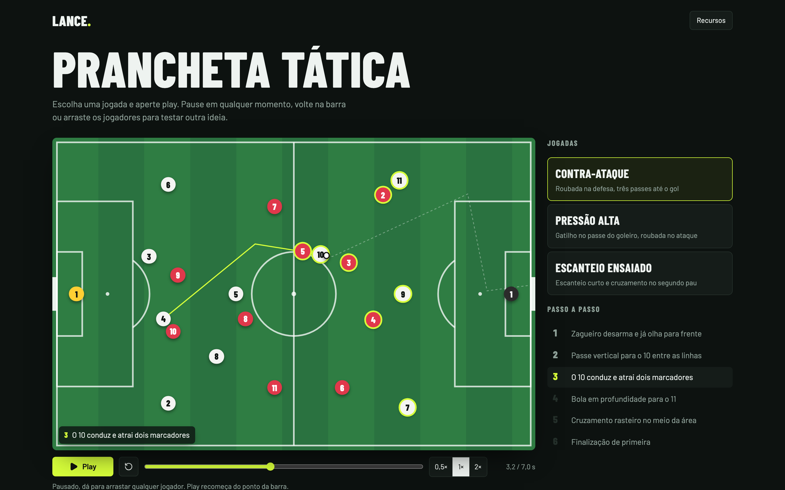
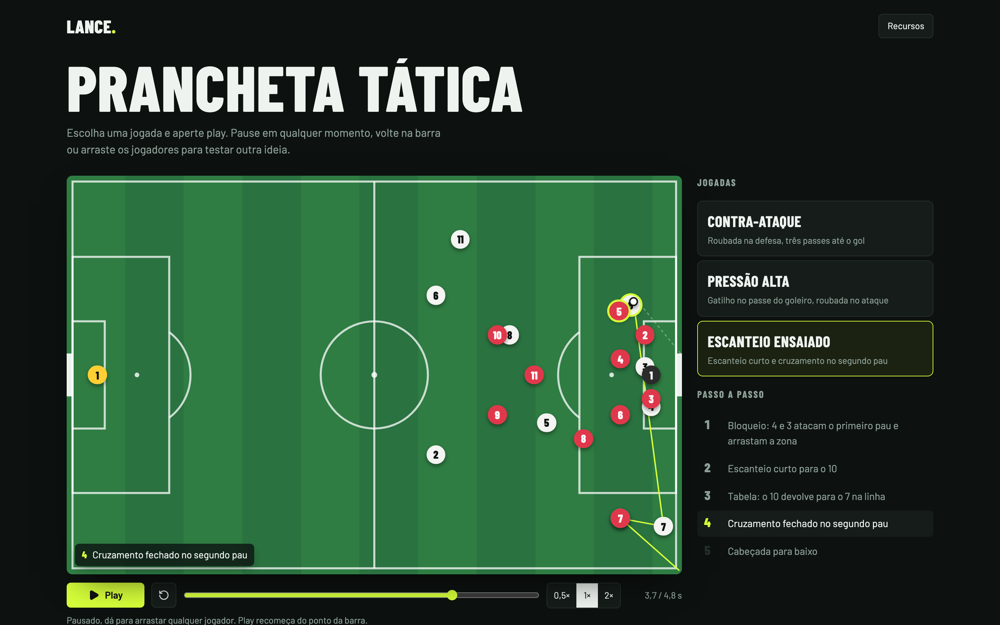
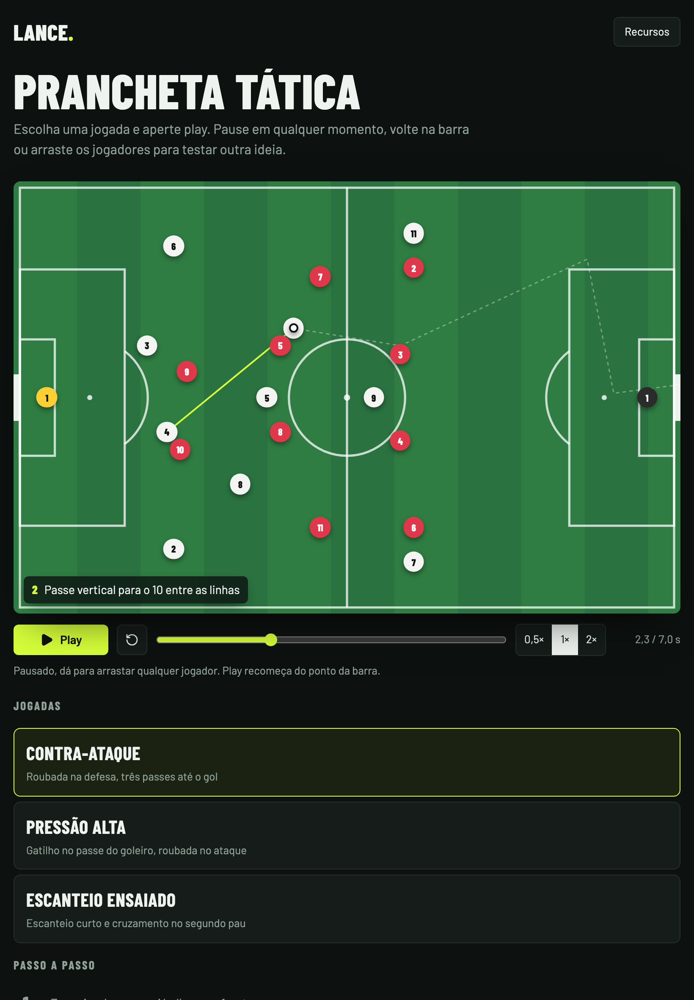
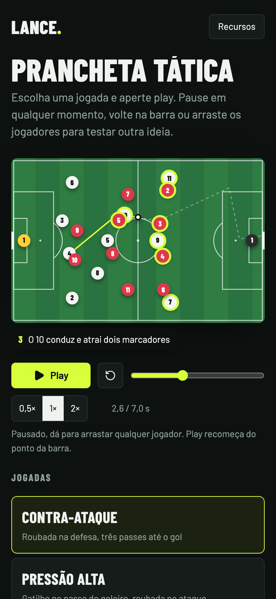
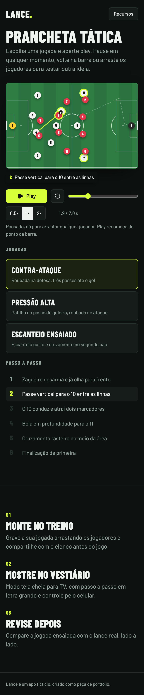

# Lance · Prancheta tática

Página de produto de um app fictício de prancheta tática. Escolha uma jogada e aperte play: os jogadores se movem passo a passo, com narração, rastro da bola e controles de vídeo. Pause em qualquer momento, volte na barra ou arraste os jogadores para testar outra ideia.





<p align="center">
  
  &nbsp;
  
  &nbsp;
  
</p>

## O que dá pra fazer

- **Três jogadas**: contra-ataque, pressão alta e escanteio ensaiado, cada uma com o seu passo a passo
- **Controles de vídeo**: play e pausa, voltar ao início, barra para avançar ou voltar e velocidade de 0,5×, 1× e 2×
- **Passo a passo clicável**: tocar num passo leva a jogada até ele e continua dali
- **Narração** do passo atual sobre o campo (abaixo dele no celular) e destaque nos jogadores que estão se movendo
- **Rastro da bola**: o caminho planejado tracejado, e o que já foi jogado desenhado conforme a bola anda
- **Arrastar jogadores e a bola** com o mouse ou o toque quando a jogada está pausada; o play continua de onde você deixou e os próximos movimentos partem da nova posição
- Ao trocar de jogada ou reiniciar, os jogadores voltam para a formação com animação

Funciona com mouse, teclado e toque. No celular a página rola normalmente por cima do campo: só o jogador que você toca captura o gesto.

## Tecnologias

| Tecnologia                                                                   | Uso                                                |
| ---------------------------------------------------------------------------- | -------------------------------------------------- |
| [Next.js 16](https://nextjs.org) (App Router)                                | framework, renderização estática e fontes          |
| [React 19](https://react.dev) + [TypeScript](https://www.typescriptlang.org) | interface e tipagem                                |
| [Motion](https://motion.dev)                                                 | relógio da jogada, entradas, narração e transições |
| [Tailwind CSS 4](https://tailwindcss.com)                                    | estilos e layout responsivo                        |
| [Lucide](https://lucide.dev)                                                 | ícones                                             |
| [Playwright](https://playwright.dev)                                         | geração dos prints deste README                    |
| ESLint + Prettier                                                            | padrão de código e formatação                      |

## Como rodar

Precisa de [Node.js](https://nodejs.org) 22 ou mais recente.

```bash
npm install
npm run dev
```

Abra http://localhost:3000. Para testar no celular na mesma rede Wi-Fi, rode `npm run dev -- -H 0.0.0.0` e acesse `http://<ip-do-seu-computador>:3000`.

### Comandos

| Comando               | O que faz                                                                                       |
| --------------------- | ----------------------------------------------------------------------------------------------- |
| `npm run dev`         | servidor de desenvolvimento                                                                     |
| `npm run build`       | verifica os tipos e gera a versão de produção                                                   |
| `npm run start`       | serve a versão de produção (depois do build)                                                    |
| `npm run lint`        | ESLint                                                                                          |
| `npm run format`      | Prettier em todo o projeto                                                                      |
| `npm run check`       | testa o domínio: linha do tempo, posições, arraste e passo ativo                                |
| `npm run screenshots` | gera os prints em `docs/` (depois do build; na primeira vez, `npx playwright install chromium`) |

## Estrutura

```
src/
├── app/                 layout, página e estilos globais (Next.js)
├── domain/tactics.ts    regras sem React: escalações, jogadas, linha do tempo e
│                        positionsAt(tempo), que calcula onde cada um está, inclusive arrastado
├── hooks/usePlayback.ts relógio da jogada: play, pausa, barra, velocidade, troca e arraste
├── components/
│   ├── atoms/           Token (jogador ou bola)
│   ├── molecules/       Pitch, PitchMarkings, Transport, PlayList, StepList, StepCaption
│   └── organisms/       Header, Hero, Board, Features, Footer
├── lib/                 utilitário cn
└── constants/           curvas de animação
```

Imports usam aliases: `@atoms/*`, `@molecules/*`, `@organisms/*`, `@domain/*`, `@hooks/*`, `@lib/*`, `@constants/*`.

---

Produto fictício, criado como peça de portfólio.
